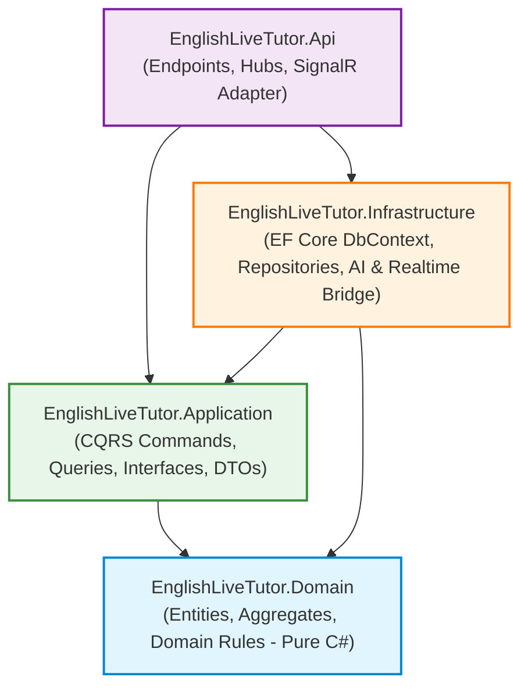
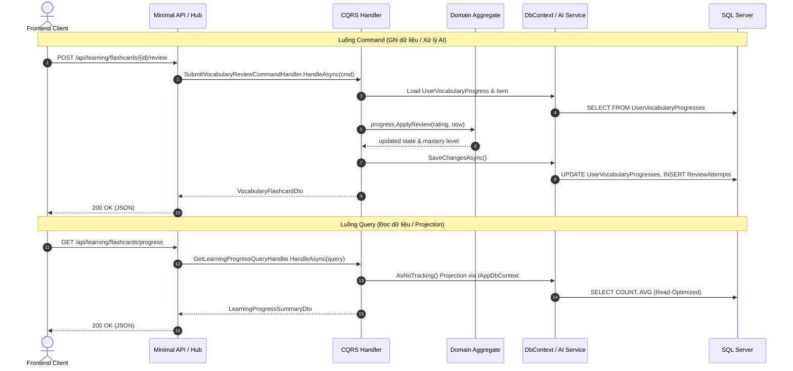

# EnglishLiveTutor - Kiến Trúc Pragmatic Clean Architecture + DDD + CQRS

Tài liệu thiết kế kiến trúc backend cho hệ thống EnglishLiveTutor (LingoMint) sau đợt tái cấu trúc theo nguyên lý **Pragmatic Clean Architecture**, **Domain-Driven Design (DDD)** và **Command Query Responsibility Segregation (CQRS)**.

---

## 1. Trách nhiệm của các Project trong Solution

Hệ thống backend được chia thành 4 project C# (.NET 10.0) với ranh giới trách nhiệm rõ ràng:

```
backend/
├── EnglishLiveTutor.Api.csproj         # Composition Root, Minimal APIs, SignalR Hubs & Adapters
├── Program.cs                           # Bootstrap, DI Configuration, Middleware & Route Mappings
├── Endpoints/                           # Minimal API feature endpoints
├── Hubs/                                # SignalR Hubs (/hubs/tutor, /hubs/transcribe, /hubs/translate)
├── Realtime/                            # SignalR Adapter (SignalRLiveSessionRealtimeNotifier)
├── src/
│   ├── EnglishLiveTutor.Domain/         # Core Domain Entities, Aggregates & Business Rules
│   ├── EnglishLiveTutor.Application/    # CQRS Commands/Queries, Handlers, DTOs & Interfaces
│   └── EnglishLiveTutor.Infrastructure/ # Persistence (EF Core), Google Gemini AI & Live Realtime Bridge
└── docs/
    └── architecture.md                  # Tài liệu kiến trúc này
```

### 1.1 `EnglishLiveTutor.Domain`
- **Mục tiêu:** Trái tim của hệ thống, chứa các Entity, Aggregate Root, Value Object và các quy tắc nghiệp vụ cốt lõi.
- **Ràng buộc:** **Pure C#** — độc lập 100%, **0 dependency** bên ngoài (không phụ thuộc EF Core, ASP.NET Core, SignalR, HttpClient hay bất kỳ thư viện thứ 3 nào).
- **Quy tắc nghiệp vụ được đóng gói:**
  - `UserVocabularyProgressEntity.ApplyReview`: Thuật toán lặp lại ngắt quãng (SM-2 Spaced Repetition) xác định khoảng cách ngày ôn tập (`IntervalDays`), hệ số dễ nhớ (`EaseFactor`), cấp độ thành thạo (`MasteryLevel`) và trạng thái học (`LearningStatus: Learning -> Review -> Mastered`).
  - `DailyVocabularyPlanEntity.Complete`: Quy tắc đóng kế hoạch học ngày và `ResolveLocalLearningDate` tính toán ngày học cục bộ theo timezone (mặc định `Asia/Ho_Chi_Minh`).
  - `VocabularyEntity.NormalizeWord`: Quy tắc chuẩn hóa từ vựng (lowercase, collapse whitespace, deduplication key).
  - `ScoringRubricEntity.ValidateWeights`: Quy tắc bắt buộc tổng trọng số các tiêu chí chấm phát âm phải đúng 100.00%.
  - `PronunciationAssessmentEntity.CalculateWeightedScore`: Công thức tính điểm có trọng số làm tròn chuẩn hóa `Math.Round(rawScore * weight / 100.00m, 2)`.
  - `ConversationEntity.UpdateTitleFromFirstUserMessage`: Tự động đặt tiêu đề thông minh từ tin nhắn đầu tiên của người học.

### 1.2 `EnglishLiveTutor.Application`
- **Mục tiêu:** Điều phối ca sử dụng (Use Cases) theo mô hình CQRS.
- **Ràng buộc:**
  - Phụ thuộc duy nhất vào `EnglishLiveTutor.Domain`.
  - **Không** phụ thuộc `EnglishLiveTutor.Infrastructure` hay `EnglishLiveTutor.Api`.
  - **Không** sử dụng MediatR — sử dụng cấu trúc Direct DI (`ICommandHandler<TCommand, TResult>`, `IQueryHandler<TQuery, TResult>`) gọn gàng, Type-safe và không overhead.
  - Sử dụng interface trừu tượng: `IAppDbContext`, `IAppDbContextFactory`, `IConversationRepository`, `ILiveSessionRealtimeNotifier`, `IVocabularyAiGenerator`, `IPronunciationAiAssessor`.

### 1.3 `EnglishLiveTutor.Infrastructure`
- **Mục tiêu:** Triển khai các chi tiết kỹ thuật (Persistence, External AI, WebSocket Audio Streaming).
- **Thành phần:**
  - `Persistence/AppDbContext`: EF Core SQL Server DbContext với Fluent API cấu hình 22 bảng, không làm ô nhiễm Domain.
  - `Persistence/DatabaseSeeder`: Khởi tạo dữ liệu mẫu, AI Model Catalog (Gemini 3.8 Flash, Gemini 3.5 Transcribe Live, v.v.), Rubric mẫu.
  - `Persistence/Migrations`: Bộ EF Core migrations đồng bộ với cơ sở dữ liệu SQL Server.
  - `Repositories/ConversationRepository`: Triển khai truy xuất và cập nhật lịch sử hội thoại.
  - `Ai/GeminiVocabularyAiGenerator`: Gọi Google Generative Language API (`/v1beta/models/...:generateContent`) sinh từ vựng chuẩn CEFR dạng JSON.
  - `Ai/GeminiPronunciationAiAssessor`: Gửi audio trực tiếp lên Gemini để chấm điểm phát âm đa tiêu chí (Accuracy, Clarity, Fluency).
  - `Ai/FastTextTranslatorFallback`: Dịch câu thoại song ngữ Anh - Việt.
  - `Ai/GrammarCorrectionAnalyzerService`: Phân tích lỗi ngữ pháp/chính tả và trích xuất sửa lỗi từ giáo viên AI.
  - `Realtime/GeminiLiveSessionBridge`: Quản trị kết nối WebSocket 2 chiều với Google BidiGenerateContent API, tự động reconnect.
  - `Realtime/GeminiLiveConnectionManager`: Điều phối 3 session AI (Tutor, Transcribe, Translate) độc lập với SignalR thông qua `ILiveSessionRealtimeNotifier`.

### 1.4 `EnglishLiveTutor.Api`
- **Mục tiêu:** Composition Root, tiếp nhận HTTP request và WebSocket SignalR connection.
- **Thành phần:**
  - `Program.cs`: Cấu hình DI, CORS, SignalR, middleware và ánh xạ endpoints.
  - `Endpoints/`: Đăng ký Minimal API theo từng feature (`ConversationEndpoints`, `VocabularyEndpoints`, `DailyLearningEndpoints`, `PronunciationEndpoints`, `HealthEndpoints`).
  - `Hubs/`: 3 SignalR Hubs (`TutorConversationHub`, `TranscribeLiveHub`, `TranslateLiveHub`).
  - `Realtime/SignalRLiveSessionRealtimeNotifier`: Adapter hiện thực `ILiveSessionRealtimeNotifier`, chuyển tiếp các event từ `GeminiLiveConnectionManager` đến các SignalR Hub Context tương ứng.

---

## 2. Dependency Diagram

Sơ đồ phụ thuộc chuẩn Clean Architecture (chiều mũi tên thể hiện chiều tham chiếu `ProjectReference`):



> [!NOTE]
> - `Domain` nằm ở trung tâm và không có bất kỳ mũi tên đi ra nào.
> - `Application` chỉ tham chiếu `Domain`.
> - `Infrastructure` hiện thực các interface do `Application` định nghĩa.
> - `Api` đóng vai trò gắn kết (Composition Root) qua `AddApplicationServices()` và `AddInfrastructureServices()`.

---

## 3. Ranh giới Nghiệp vụ và Aggregates (DDD)

| Aggregate Root | Entity con & Value Objects | Quy tắc nghiệp vụ chính |
| :--- | :--- | :--- |
| **ConversationEntity** | `ChatMessageEntity`, `LanguageCorrectionEntity` | Quản lý hội thoại thời gian thực, lưu trữ 2 dòng phụ đề (English & Vietnamese), trích xuất và liên kết lỗi ngữ pháp theo Turn. |
| **VocabularyEntity** | `VocabularySenseEntity`, `VocabularyPronunciationEntity`, `VocabularyWordFamilyEntity`, `VocabularyRelationEntity`, `VocabularyCollocationEntity`, `VocabularyExampleEntity`, `VocabularyGrammarPatternEntity` | Chuẩn hóa từ (`NormalizeWord`), quản lý đa nghĩa (polysemy), phát âm chuẩn US/UK, họ từ, từ đồng nghĩa/trái nghĩa, câu ví dụ CEFR. |
| **DailyVocabularyPlanEntity** | `DailyVocabularyItemEntity` | Lập kế hoạch học ngày theo múi giờ địa phương, giới hạn từ mới/từ ôn, kiểm tra hoàn thành kế hoạch. |
| **UserVocabularyProgressEntity** | `VocabularyReviewAttemptEntity` | Quản lý thuật toán SM-2: tính toán số lần ôn, hệ số dễ nhớ (`EaseFactor`), bước nhảy ngày (`IntervalDays`) và cấp độ thành thạo (`MasteryLevel`). |
| **ScoringRubricEntity** | `ScoringRubricCriterionEntity` | Tiêu chí chấm phát âm v1 (`ENGLISH_PRONUNCIATION_V1`), kiểm tra tổng trọng số 100%. |
| **PronunciationAssessmentEntity**| `AudioRecordingEntity`, `PronunciationCriterionScoreEntity` | Đánh giá bản ghi âm (WAV/WebM), tính điểm thành phần và điểm tổng quát (`CalculateWeightedScore`), lưu trữ snapshot phản hồi AI. |

---

## 4. Luồng xử lý CQRS (Command / Query Flow)



---

## 5. Các quyết định thiết kế Pragmatic

1. **Direct DI thay vì MediatR:**
   - Sử dụng generic interface trực tiếp:
     - `ICommand<TResult>` & `ICommandHandler<TCommand, TResult>`
     - `IQuery<TResult>` & `IQueryHandler<TQuery, TResult>`
   - Giữ mã nguồn sáng sủa, tường minh, IDE điều hướng trực tiếp bằng "Go to Implementation" (F12), không phụ thuộc reflection runtime của third-party library.

2. **IAppDbContext trong Application:**
   - Application sở hữu interface `IAppDbContext` để thực hiện các truy vấn LINQ bất đồng bộ (`ToListAsync`, `FirstOrDefaultAsync`, `AsNoTracking`).
   - Tránh việc tạo hàng chục Generic Repository rỗng (`IRepository<T>`) gây cản trở truy vấn LINQ phức tạp và phát sinh overhead mapping không cần thiết.

3. **Tách biệt Realtime Notifier khỏi SignalR Context:**
   - `GeminiLiveConnectionManager` trong Infrastructure chỉ phụ thuộc vào `ILiveSessionRealtimeNotifier`.
   - Lớp Api cung cấp `SignalRLiveSessionRealtimeNotifier` để ánh xạ các cuộc gọi đến SignalR groups. Nhờ đó, Infrastructure hoàn toàn không cần phụ thuộc gói `Microsoft.AspNetCore.SignalR`.

4. **Biên dịch độc lập & Exclusions:**
   - `EnglishLiveTutor.Api.csproj` được cấu hình `<Compile Remove="src\**" />` và `<Compile Remove="tests\**" />` giúp MSBuild không biên dịch lặp lại mã nguồn của các sub-project.

---

## 6. Hướng dẫn Build, Chạy và Công cụ EF Core

### 6.1 Build toàn bộ Solution
```powershell
cd D:\Projects\EnglishTutor\backend
dotnet build ..\EnglishLiveTutor.sln
```

### 6.2 Chạy bộ Unit Tests
```powershell
dotnet test tests\EnglishLiveTutor.Domain.Tests\EnglishLiveTutor.Domain.Tests.csproj
```

### 6.3 Chạy Backend API Server
```powershell
dotnet run --project EnglishLiveTutor.Api.csproj
```

### 6.4 EF Core Migrations Tooling
Khi cần tạo hoặc cập nhật migration mới:
```powershell
dotnet ef migrations add <MigrationName> `
  --project src\EnglishLiveTutor.Infrastructure\EnglishLiveTutor.Infrastructure.csproj `
  --startup-project EnglishLiveTutor.Api.csproj `
  --output-dir Migrations
```

---

## 7. Đảm bảo Tính tương thích (Compatibility) và Giới hạn Kiểm chứng

### 7.1 Tính tương thích đã được bảo toàn 100%:
- **REST Endpoints:** Giữ nguyên toàn bộ 14 đường dẫn URL, HTTP method, query/body parameter và cấu trúc JSON trả về.
- **SignalR Hubs:** Giữ nguyên 3 hub paths (`/hubs/tutor`, `/hubs/transcribe`, `/hubs/translate`), các method gọi từ client và tên event broadcast (`ReceiveTutorAudio`, `ReceiveInteractionStatus`, `ReceiveTranscriptLine1`, `ReceiveTranslationLine2`, `ReceiveLanguageCorrection`, `TutorInterrupted`).
- **Domain Algorithms:** Bảo toàn chính xác thuật toán SM-2, công thức làm tròn điểm phát âm, logic trích xuất sửa lỗi ngữ pháp.

### 7.2 Giới hạn kiểm chứng (Verification Scope):
- Đã kiểm chứng: Biên dịch thành công 100% 4 project chính và 1 project test (0 Warning, 0 Error); tất cả Unit Tests Domain Logic chạy pass.
- Giới hạn: Không thực hiện chạy migration trực tiếp hoặc ghi dữ liệu lên SQL Server thực tế trong quá trình refactor nhằm đảm bảo an toàn toàn vẹn dữ liệu người dùng.
